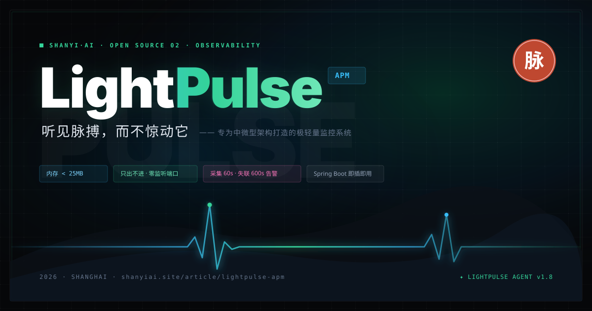
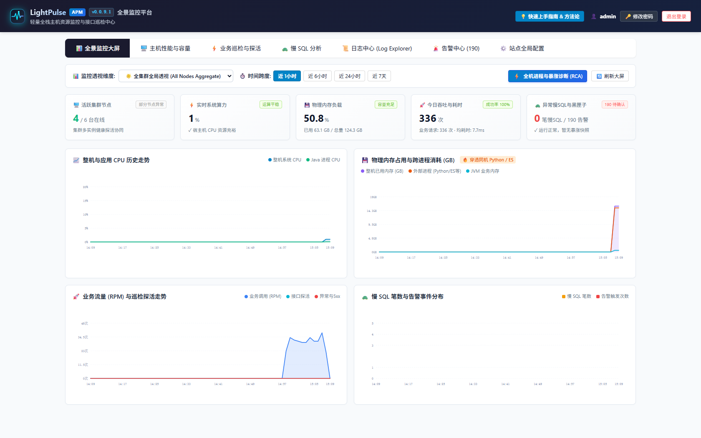
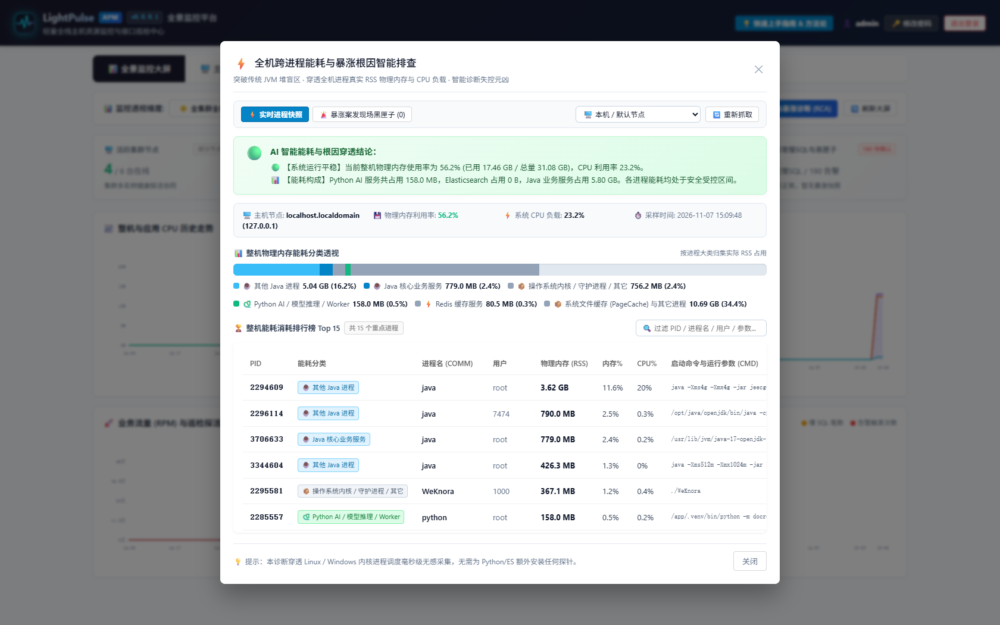
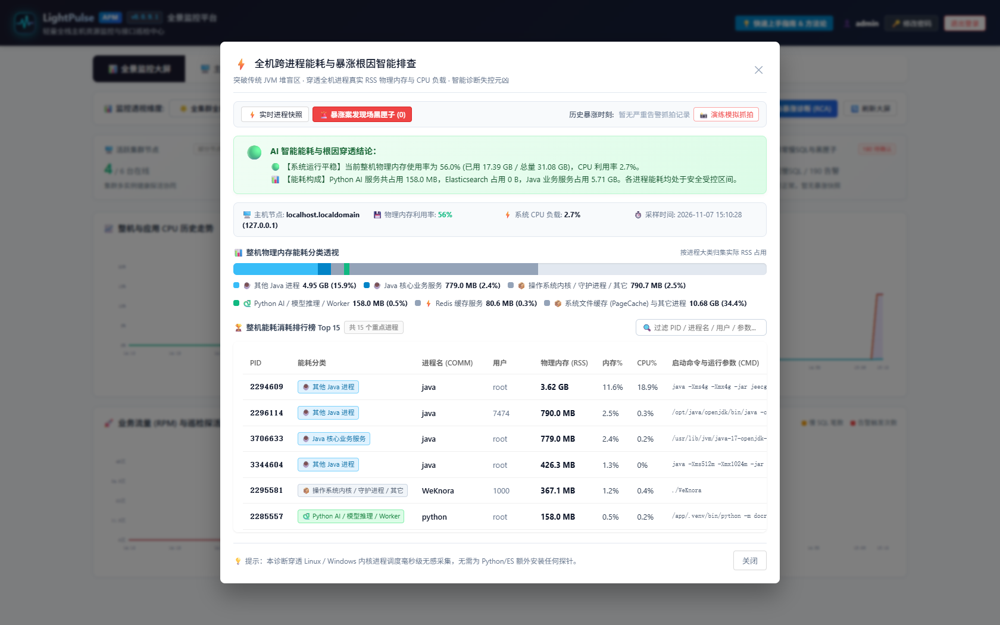
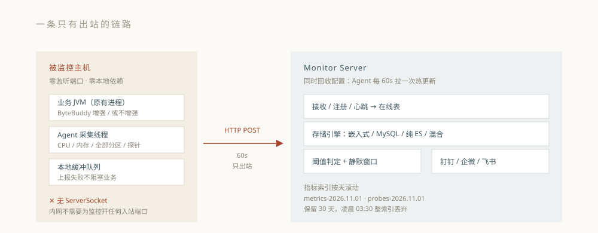

# LightPulse APM (轻脉监控系统)

<p align="center">
  
</p>

<p align="center">
  
  
  
  
  
</p>

> **LightPulse APM** 是一套专为企业私有化内网、混合云、微服务与混合部署（Java + Python AI + ES 等）量身打造的高性能、轻量级、零侵入的现代化应用性能监控、全机进程根因排查（OS RCA）、暴涨案发现场黑匣子与动态业务接口巡检拨测系统。

---

## 🌟 核心特性与架构优势

1. **⚡ 全景时序监控大屏（v0.0.9 重磅）**
   - **双维度回溯**：支持“全集群全局汇总透视”与“单机实例下钻”，1h / 6h / 24h / 7d 多时间跨度。
   - **内网离线自洽**：原生 SVG 矢量渲染，零外部 CDN 依赖，在政企内网高隔离环境下 100% 稳定运行。
   - **四维动态趋势**：整机系统 vs Java 进程 CPU 走势、物理总内存 vs JVM vs 外部进程堆叠面积图、真实业务 HTTP 请求量 (RPM/QPS) 与探活吞吐、慢 SQL 与告警分布。

2. **🔍 宿主机跨进程能耗与暴涨根因智能排查（OS Process RCA）**
   - **突破传统 JVM 堆盲区**：绝大多数 APM 只能看 JVM 内部堆内存，一旦同机混部的 Python AI 大模型推理进程、Elasticsearch 或后台脚本把整机内存吃满时完全抓瞎。
   - **穿透全机进程 RSS 真实内存**：自动识别并分类 `Python AI/推理 Worker`、`Java 核心服务`、`Elasticsearch`、`Redis`、`PageCache`，并生成精准的中文排障与归因结论。

3. **🚨 暴涨案发现场黑匣子（Crime Scene Snapshot Blackbox）**
   - **告别“事后诸葛亮”**：当机器 CPU 或物理内存触发高压阈值瞬间，后台自动抓拍并永久留存当时 Top 15 进程快照。即使凌晨 2 点异常进程退出或被 OOM-Killer 杀死，次日早晨依然可以 1:1 还原案发现场！

4. **🚀 极致轻量 & 零侵入**
   - **Agent 纯 Java 实现**：无任何 C/OS 动态链接库，单探针内存稳定 `< 30MB`，CPU 占用率低于 `0.1%`。
   - **纯出站安全（Zero-Inbound Port）**：探针不监听任何本地 TCP 端口，杜绝内网端口扫描与渗透风险。

5. **🔐 企业级安全与用户权限中心**
   - **RBAC 角色权限体系**：原生支持 `ADMIN`（超级管理员）与 `VIEWER`（只读观察员）严格权限拦截隔离。
   - **高强度密码防护**：采用加盐 **PBKDF2 (10,000 次哈希迭代)** 算法替代传统弱哈希，内置图形验证码与 IP 爆破安全锁定。

6. **🔄 双模部署 & 双版本 Starter 开箱即用**
   - **独立运行模式**：独立 Server 进程运行（支持内置 H2 或外置 MySQL），探针秒级接入；
   - **嵌入式 Starter**：原生适配 Spring Boot 2.x 与 Spring Boot 3.x，在业务工程 `pom.xml` 中引入 starter 即可直接激活全套监控看板。

---

## 🖼️ 系统视觉全景走廊 (Visual Showcase)

### 1. 全景监控大屏与业务态势感知


### 2. 宿主机全机进程能耗穿透排查 (OS RCA)


### 3. 暴涨案发现场黑匣子与快照模拟


### 4. 架构数据流向与生命周期


---

## 📁 模块结构概览

```text
lightpulse-apm/
├── pom.xml                          # 聚合工程根 POM (统一构建与模块调度)
├── monitor-server/                  # 独立 APM 监控中心服务端 (Spring Boot 3.x + H2/MySQL + 前端大屏)
├── monitor-agent/                   # 独立主机探针 / JavaAgent (ByteBuddy 增强, 纯出站上报)
├── monitor-spring-boot2-starter/    # Spring Boot 2.x 嵌入式轻脉监控 Starter
├── monitor-spring-boot3-starter/    # Spring Boot 3.x 嵌入式轻脉监控 Starter
├── deploy-linux/                    # Linux 生产部署一键脚本 (Server/Agent 启停、systemd 守护)
│   ├── server/                      # 独立服务端产物与启停脚本 (monitor-server-0.0.9.jar)
│   └── agent/                       # 客户端探针产物与配置 (monitor-agent-0.0.9.jar)
├── docs/                            # 架构设计方案、生产部署与 Maven 发布手册
│   └── images/                      # 高清架构矢量图与系统运行实况截图
└── scripts/sql/                     # 生产环境预设配置与初始化 SQL 脚本
```

---

## 🚀 快速上手

### 1. 编译全套工程

本项目要求 **JDK 17+** 与 **Maven 3.8+**。在根目录下执行：

```bash
# 编译全模块
mvn clean compile

# 打包全模块 Jar 包
mvn clean package -DskipTests
```

---

### 2. 模式 A：独立服务端与探针部署（推荐生产方案）

#### 启动服务端 (Monitor Server)
服务端默认使用开箱即用的内嵌 H2 数据库（保存在 `./data/monitor_db`，启动即用，无需配置外部数据库）；亦可无缝对接外部 MySQL 5.7 / 8.0：

```bash
cd deploy-linux/server
bash start.sh
```
- 控制台大屏访问地址：`http://<SERVER_IP>:8086/apm/index.html`
- 默认登录账户：管理员 `admin / admin123`，只读观察员 `viewer / viewer123`
- 启停脚本：`status.sh`、`stop.sh`、`restart.sh`
- 开机自启守护：将 `monitor-server.service` 拷贝至 `/etc/systemd/system/` 即可。

#### 启动客户端探针 (Monitor Agent)
配置 `deploy-linux/agent/config.json` 中的服务端上报地址：
```json
{
  "serverUrl": "http://127.0.0.1:8086",
  "appName": "prod-gateway-01",
  "intervalSeconds": 60
}
```
运行探针：
```bash
cd deploy-linux/agent
bash start.sh
```

---

### 3. 模式 B：业务工程集成 Starter（嵌入式监控）

#### Spring Boot 3.x 工程引入：
```xml
<dependency>
    <groupId>io.github.chaoking320</groupId>
    <artifactId>monitor-spring-boot3-starter</artifactId>
    <version>0.0.9</version>
</dependency>
```

#### Spring Boot 2.x 工程引入：
```xml
<dependency>
    <groupId>io.github.chaoking320</groupId>
    <artifactId>monitor-spring-boot2-starter</artifactId>
    <version>0.0.9</version>
</dependency>
```

引入后启动宿主工程，直接访问 `http://<HOST>:<PORT>/apm/index.html` 即可进入专属监控中心！

---

## 📖 详细文档指引

- **[系统完整说明书与深度架构剖析](docs/LIGHTPULSE_SYSTEM_AND_DEPLOYMENT_GUIDE.md)**
- **[独立服务端 Linux 生产部署手册](docs/STANDALONE_SERVER_DEPLOYMENT_GUIDE.md)**
- **[Maven Central (中央仓库) 发版与 GPG 签名操作手册](docs/MAVEN_CENTRAL_PUBLISH_GUIDE.md)**
- **[后端核心功能增强方案](docs/BACKEND_CORE_ENHANCEMENTS.md)**
- **[全方位增强计划汇总](docs/COMPREHENSIVE_ENHANCEMENT_SUMMARY.md)**

---

## 📄 开源许可证

本项目基于 [Apache License 2.0](LICENSE) 开源。
