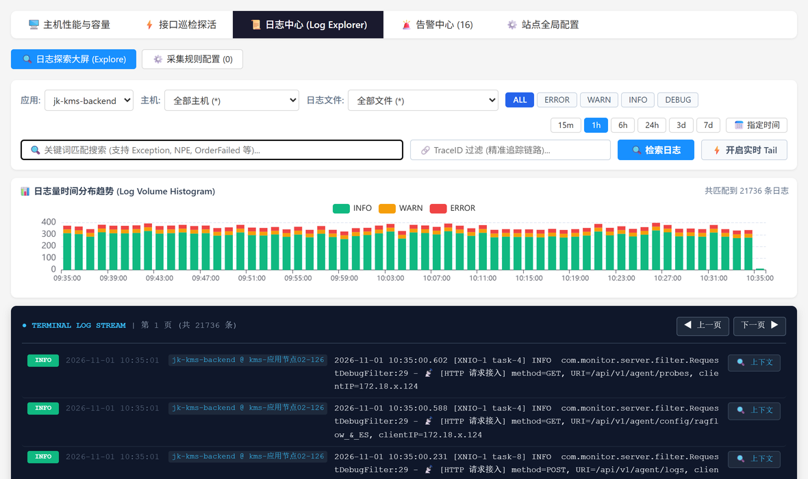
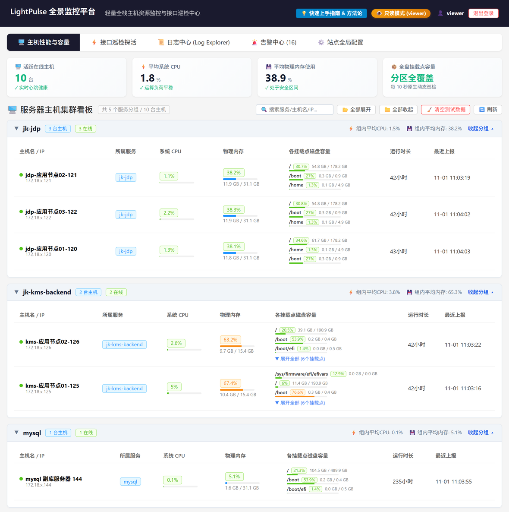
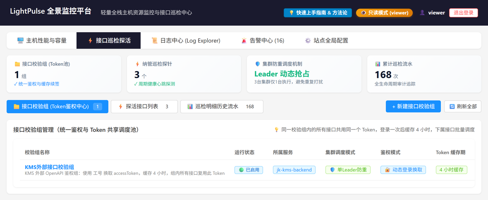
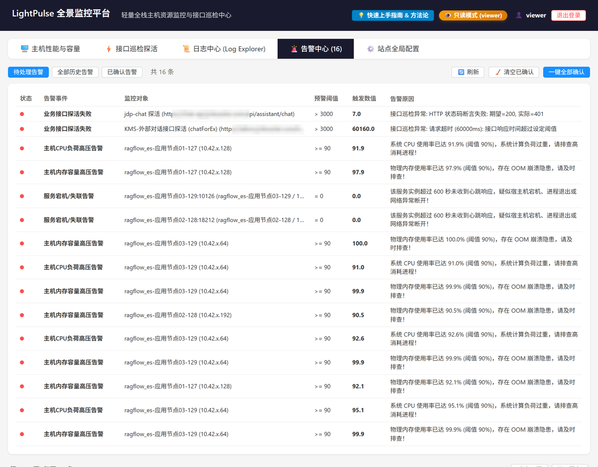

# LightPulse APM

<p align="center">
  
</p>

<p align="center">
  
  
  
  
  
</p>

<p align="center">
  <b>English</b> | <a href="README_zh.md">简体中文</a>
</p>

> **LightPulse APM** is a lightweight, zero-intrusion, full-stack observability platform built for **private intranets, hybrid clouds, and mixed-runtime servers** (Java + Python AI + Elasticsearch + Redis on the same host). It unifies **Panoramic Time-Series Dashboards, Cross-Process OS Root-Cause Analysis (OS RCA), OOM/Spike Crime-Scene Snapshots, a built-in Log Explorer, All-Mount Disk Monitoring, and Dynamic API Probes** into a single lightweight Java binary.

<p align="center">
  <a href="https://apm.demo.shanyiai.site/login.html?demo=1" target="_blank">
    
  </a>
</p>

> 🌐 **Try the Live Demo (No Sign-Up Required)**: https://apm.demo.shanyiai.site/login.html?demo=1  
> *(Opens directly in read-only `VIEWER` demo mode with real host metrics, OS Process RCA, Log Explorer, and Alert Center.)*

---

## 💡 Why LightPulse APM?

Traditional Java APMs only see inside the **JVM Heap**. When a **Python AI inference worker**, **Elasticsearch**, or runaway background script eats 95% of physical RAM on the same machine, standard Java APMs report "everything looks fine" — right before the Linux OOM-Killer terminates your service at 2:00 AM.

| Production Pain Point | ❌ Traditional JVM APM / Heavy Stacks | ⚡ LightPulse APM |
| :--- | :--- | :--- |
| **Mixed Java + Python AI / ES Hosts** | Blind to non-JVM processes; only tracks JVM heap | **OS-Level Process RCA**: Classifies actual RSS & CPU across `Java`, `Python AI`, `Elasticsearch`, `Redis`, and `PageCache` |
| **2:00 AM OOM / CPU Spike Forensics** | Process already exited or got OOM-killed before morning | **Crime Scene Blackbox**: Automatically captures Top-15 process snapshots the exact second thresholds trigger |
| **Log Collection Overhead** | Requires deploying Filebeat + Logstash + Kibana | **Built-in Log Explorer**: Zero-dependency incremental cursor tailing (`Inode + Offset`), multiline stack grouping, TraceId filter |
| **Air-Gapped / Private Intranets** | Heavy stacks or external CDN dependencies fail offline | **Self-Contained Single JAR**: Embedded H2 out of the box (optional MySQL / Pure ES), outbound-only Agent |
| **Authenticated API Health Checks** | Simple `curl` fails on dynamic tokens & multi-pod duplicates | **Token State Machine + Cluster Leader Lock**: Caches & auto-refreshes login tokens; only 1 pod probes per interval |

---

## 🌟 Core Features

1. **⚡ Panoramic Time-Series Dashboard**
   - Switch seamlessly between **Cluster-Wide Aggregation** and **Single-Node Drill-Down** (`1h / 6h / 24h / 7d`).
   - 4-dimension live trends: Host vs. Java CPU, Physical RAM vs. JVM vs. External Processes stacked area, HTTP Traffic (RPM) & Probe health, Slow SQL & Alert distribution.
2. **🔍 Cross-Process OS Root-Cause Analysis (OS RCA)**
   - Inspects real host RSS physical memory and CPU usage across every process on the machine without installing Python/ES sidecars, generating instant human-readable root-cause diagnostics.
3. **🚨 Crime Scene Snapshot Blackbox**
   - Freezes Top-15 OS processes on CPU/Memory spike alerts so you can replay the exact state of the machine hours after a short-lived job or OOM event has passed.
4. **📜 Built-in Lightweight Log Explorer**
   - Incremental file tailing with rolling log auto-detection, multiline Java exception aggregation, `INFO/WARN/ERROR` volume histograms, wildcard/phrase/TraceId search, and one-click surrounding context logs.
5. **💻 Host Capacity & Full-Partition Disk Monitoring**
   - Groups hosts automatically by `appName` with real-time alerts for `/`, `/home`, `/boot`, and `/data` mount points.
6. **🎯 Dynamic API Probing & Token Auto-Refresh**
   - Supports dynamic login token exchange, JSONPath assertions, and cluster-wide single-Leader execution so multi-node deployments never spam downstream APIs.
7. **🔐 Enterprise Security & RBAC**
   - `ADMIN` and read-only `VIEWER` roles (strictly blocks mutations in demo/viewer mode), salted **PBKDF2 (10,000 iterations)** password hashing, graphical captcha, and brute-force IP lockout.

---

## 🖼️ Visual Showcase

> *Note: Screenshots below are from a live deployment (UI labels are in Chinese; an English UI option is on the roadmap).*

### 1. Panoramic Monitoring Dashboard


### 2. Cross-Process OS Root-Cause Analysis (OS RCA)


### 3. Crime Scene Snapshot Blackbox


### 4. Lightweight Log Explorer


### 5. Host Cluster & Full-Partition Disk Board


### 6. API Probe Auth Groups & History


### 7. Multi-Channel Alert Center (DingTalk / WeCom / Feishu)


---

## 📁 Project Structure

```text
lightpulse-apm/
├── pom.xml                          # Root multi-module Maven build
├── monitor-server/                  # Standalone APM Server (Spring Boot 3 + H2/MySQL/Pure ES + Dashboard)
├── monitor-agent/                   # Standalone Host & ByteBuddy JavaAgent (outbound-only reporting)
├── monitor-spring-boot2-starter/    # Embedded Spring Boot 2.x Starter
├── monitor-spring-boot3-starter/    # Embedded Spring Boot 3.x Starter
├── deploy-linux/                    # Ready-to-run Linux scripts & systemd units
└── docs/                            # Architecture & deployment guides
```

---

## 🚀 Quick Start

**Requirements**: **JDK 17+** and **Maven 3.8+**.

### Option A: Standalone Server + Agent (Recommended)

```bash
# 1. Build all modules
mvn clean package -DskipTests

# 2. Start the APM Server (uses embedded H2 out of the box, zero DB setup)
cd deploy-linux/server
bash start.sh
```
- Console URL: `http://<SERVER_IP>:8086/apm/index.html`
- Default accounts: `admin / admin123` (Admin), `viewer / viewer123` (Read-Only)

Configure `deploy-linux/agent/config.json` and start the Agent on target hosts:
```json
{
  "serverUrl": "http://127.0.0.1:8086",
  "appName": "prod-gateway-01",
  "intervalSeconds": 60
}
```
```bash
cd deploy-linux/agent
bash start.sh
```

### Option B: Embedded Spring Boot Starter

> Note: Maven Central currently hosts `0.0.7`. To run `0.0.11` with all latest features, run `mvn clean install -DskipTests` locally or grab prebuilt JARs from [GitHub Releases](https://github.com/chaoking320/lightpulse-apm/releases).

**Spring Boot 3.x:**
```xml
<dependency>
    <groupId>io.github.chaoking320</groupId>
    <artifactId>monitor-spring-boot3-starter</artifactId>
    <version>0.0.7</version>
</dependency>
```

**Spring Boot 2.x:**
```xml
<dependency>
    <groupId>io.github.chaoking320</groupId>
    <artifactId>monitor-spring-boot2-starter</artifactId>
    <version>0.0.7</version>
</dependency>
```

Start your Spring Boot application and open `http://<HOST>:<PORT>/apm/index.html`.

---

## 📄 License

Licensed under the [Apache License 2.0](LICENSE).
