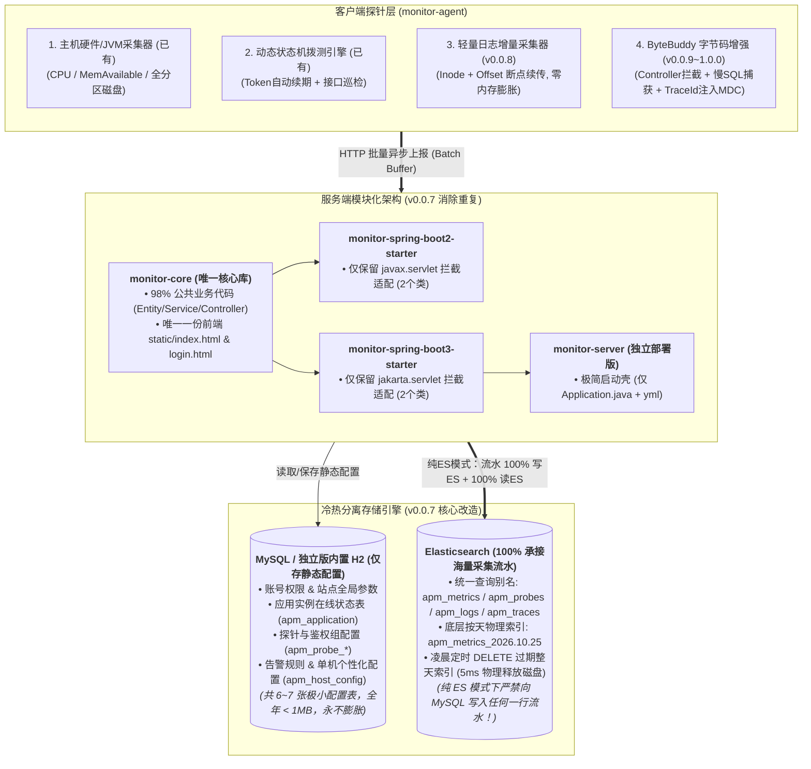

# LightPulse APM 架构重构与 1.0.0 演进实施计划书

> **制定时间**：2026-10-24  
> **当前基线版本**：`v0.0.6` (Maven Central 已发布)  
> **明日首战目标**：`v0.0.7`（彻底剥离 MySQL 高频流水写入、实现真·纯 ES 读写闭环、抽离 `monitor-core` 统一三端代码）  
> **终极里程碑**：`v1.0.0`（Metrics 指标 + Probes 拨测 + Logs 日志 + Traces 慢SQL/链路穿透 四位一体平台）

---

## 一、全局架构蓝图（Target Architecture）

---

## 二、分阶段版本演进路线与详细任务清单

### 🔥 第一阶段：`v0.0.7` —— 生产救急：剥离 MySQL 流水 + 三端代码大一统（明日首战）

> **核心痛点解决**：
> 1. 解决当前生产环境开启 ES 模式后依然往 MySQL 双写指标和拨测记录、导致 MySQL 表迅速膨胀且难以清理的问题；
> 2. 解决 124 等独立控制台在 ES 模式下依然只查本地库、看不到生产 ES 全量监控数据的问题；
> 3. 解决修改一处代码/页面需要手动同步 3~5 个模块的维护难题。

#### 任务 1.1：真·纯 ES 模式读写闭环（彻底剥离 MySQL 高频流水）
1. **切断 MySQL 流水写入**：
   - 改造 `SystemMetricController`：当 `storageEngineService.isEsActive()` 且处于纯 ES 模式（`ELASTICSEARCH`）时，**彻底跳过** `metricRepo.insert()` 和 `probeRecordRepo.insert()`，不再往 MySQL 写入任何一行主机指标与拨测记录。
   - 内存攒批缓冲（Batch Buffer）：将上报的指标与拨测结果通过 ES `_bulk` 批量接口高效写入。
2. **ES 按天滚动索引 + 统一别名（Alias）机制**：
   - 写入时动态按天路由索引名称：
     - 主机指标：`{prefix}metrics-yyyy.MM.dd`（如 `apm_metrics-2026.10.25`），自动绑定到别名 `apm_metrics`。
     - 拨测记录：`{prefix}probes-yyyy.MM.dd`（如 `apm_probes-2026.10.25`），自动绑定到别名 `apm_probes`。
   - 淘汰清理改造（`DataRetentionScheduler`）：
     - 废弃极其消耗 CPU 和磁盘 IO 的 `_delete_by_query`；
     - 改为每天凌晨直接调用 `DELETE /{prefix}*-{expiredDate}` 直接物理删除过期日期的整天索引（5ms 瞬间释放磁盘空间）。
3. **补齐 `EsStorageService` 查询聚合能力（读路径 100% 切入 ES）**：
   - 实现 `queryLatestForEachHost()`：使用 ES `terms`（按 `appName + hostName + ipAddress` 分组）+ `top_hits`（取 `@timestamp` 最新 1 条）聚合查询，毫秒级返回所有在线主机最新 CPU/内存/磁盘状态。
   - 实现 `queryHostHistory(hostName, minutes)`：从 `apm_metrics` 别名按时间范围查询指定主机的历史趋势折线图数据。
   - 实现 `queryProbeRecords(appName, probeName, isSuccess, page, size)`：从 `apm_probes` 别名分页检索接口拨测历史流水。
   - 改造 `ProbeConfigController` 中的 `/system-metrics/hosts`、`/system-metrics/history`、`/probes/records` 接口：当 `isEsActive()` 为 true 时，直接调用 `EsStorageService` 读取 ES 数据！

#### 任务 1.2：多模块架构合并与去重（抽离 `monitor-core`）
1. 新建 `monitor-core` 模块：
   - 下沉全部 11 个 `entity`、11 个 `repository`、全部核心 `service`、全部公共 `controller`。
   - 将 `@PostConstruct` 统一替换为 Spring 原生 `InitializingBean` 接口，消除 `javax.annotation` 与 `jakarta.annotation` 差异。
   - 只保留唯一一份 `src/main/resources/static/index.html` 与 `login.html`，通过 `WebMvcConfigurer` 将 `/apm/**` 与 `/**` 映射到同一份静态资源。
2. 瘦身 `monitor-spring-boot2-starter` 与 `monitor-spring-boot3-starter`：
   - 各自仅保留 `AuthInterceptor`（处理 `javax.servlet` vs `jakarta.servlet`）和 `MonitorAutoConfiguration`。
   - 增加 `@ConditionalOnProperty(prefix = "monitor", name = "enabled", havingValue = "true", matchIfMissing = true)` 一键启停开关。
   - 配置独立的 APM 后台定时任务线程池（`apmTaskScheduler`），防止阻塞宿主业务自身的 `@Scheduled` 任务。
3. 瘦身 `monitor-server`：
   - 移除所有重复的业务类与 HTML，直接依赖 `monitor-spring-boot3-starter`，仅保留 `MonitorApplication.java` 与 `application.yml`。

#### 任务 1.3：主机级个性化配置底座（Host-Level Config Override）
1. 新增轻量配置表 `apm_host_config`（存放在 MySQL/H2 元数据库中）：
   - 字段：`id`, `app_name`, `host_name`, `ip_address`, `cpu_threshold`, `memory_threshold`, `disk_threshold`, `log_enabled`, `log_paths_json`, `updated_at`。
2. 告警判断与配置下发遵循 **“三级就近继承原则”**：
   - `单机独立配置 (Host)` > `应用组配置 (App)` > `站点全局默认配置 (Global)`。

#### 任务 1.4：发布 `v0.0.7`
- 统一将 `monitor-spring-boot2-starter` 与 `monitor-spring-boot3-starter` 版本号升级为 `0.0.7` 并推送至 Maven Central；
- 重新打包 `monitor-server` 最新可执行 Jar 更新至 `deploy-linux/server/`。

---

### 📋 第二阶段：`v0.0.8` —— 自研轻量级日志中心（对标 Promtail + Loki 体验）

> **核心目标**：零外部采集组件依赖，通过现有 `monitor-agent` 直接增量采集指定服务器目录的日志文件，同步至 ES（绝不写 MySQL），提供毫秒级日志检索控制台。

1. **控制台日志采集配置（基于 0.0.7 的单机/应用配置）**：
   - 在主机列表及应用配置页，支持配置采集目录与文件通配符（例如 `/data/logs/*.log`、`/var/log/nginx/access.log`）、日志级别过滤、单行/多行正则匹配规则。
2. **Agent 端 `LogTailer` 增量流式采集引擎**：
   - **游标断点续传**：使用 `RandomAccessFile.seek(offset)` + 文件 `inode` 标识，将采集进度实时保存在本地 `.tail_offsets.json` 中；即使面对 10GB 大文件或 Logback 跨天切割改名，也只读新增字节，内存占用恒定 `< 5MB`。
   - **多行异常堆栈聚合**：自动识别非时间戳开头的缩进行（如 `at com.xxx...`、`Caused by:`），合并为同一条日志文档上报。
   - **限流与批量压缩上报**：单次攒满 200 条或每 1 秒通过 GZIP 压缩批量 POST 至服务端 `/api/v1/agent/logs`。
3. **Server 端 ES 日志存储与检索**：
   - 批量拼装 ES `_bulk` 写入按天索引 `apm_logs-yyyy.MM.dd`（绑定别名 `apm_logs`）。
   - 纳入凌晨定时任务，到期直接 `DELETE /apm_logs-{expiredDate}` 物理清理。
4. **前端【日志中心】大屏 Tab**：
   - 支持按应用、主机 IP、文件名、日志级别（`ERROR` / `WARN` / `INFO`）、时间范围、关键词全文搜索与高亮展示，支持实时 Tail 滚屏模式。

---

### 🔍 第三阶段：`v0.0.9` —— 慢 SQL 诊断 + 异常大盘 + 接口耗时聚合入 ES

> **核心目标**：打通 `monitor-agent` 已有的字节码拦截能力，将应用内部性能数据全面切入 ES。

1. **慢 SQL 采集与分析闭环**：
   - 完善 Agent 端 `SqlInterceptor`，支持配置慢 SQL 阈值（如 `> 500ms`），捕获完整 SQL 语句、执行耗时、连接池地址、发生位置。
   - 写入 ES `apm_traces-yyyy.MM.dd` 索引，在控制台展示【慢 SQL 排行榜】与慢 SQL 详情。
2. **Controller 接口分钟级 QPS/RT 聚合与全局异常捕获**：
   - 将 `AgentController.receiveMetrics`（接口耗时指标）与异常堆栈记录从 MySQL 剥离，全面切入 ES 读写。

---

### 🏆 第四阶段：`v1.0.0` —— 全链路 Trace 追踪与日志穿透（正式里程碑大版本）

> **核心目标**：将指标、拨测、慢 SQL、日志通过 `traceId` 彻底串联，发布 `1.0.0` GA 正式版。

1. **MDC 自动注入与全链路 TraceId 贯穿**：
   - 当请求进入 Controller 时，`monitor-agent` 自动生成全局唯一 `traceId`，并动态织入 Logback / Log4j2 的 `MDC.put("traceId", traceId)`。
   - 业务日志、慢 SQL 记录、异常记录、接口耗时 Span 全部自动携带同一个 `traceId`。
2. **控制台“一键穿透”排障体验**：
   - 在大屏看到某次接口告警、某条慢 SQL 或某个异常堆栈时，点击 **【查看关联调用链 & 日志】**，直接通过 `traceId` 从 ES `apm_traces` 和 `apm_logs` 中秒级拉出该次请求的完整调用瀑布流图及期间打印的所有业务日志！
3. **发布 `LightPulse APM v1.0.0` 正式版**：
   - `monitor-agent`、`monitor-spring-boot2-starter`、`monitor-spring-boot3-starter`、`monitor-server` 全线升级至 `1.0.0` 正式版。

---

## 三、明日（`v0.0.7`）施工执行顺序

明天我们一开工，直接按以下 4 步紧凑推进，当天即可完成并解决生产问题：

1. **Step 1（核心优先）**：先在现有代码上完成 **`EsStorageService` 查询接口补齐 + `SystemMetricController` / `ProbeConfigController` 纯 ES 模式读写切换 + 按天索引与自动删除**（直接解决生产 MySQL 膨胀与 124 查询不到 ES 数据的燃眉之急）。
2. **Step 2**：落地 **主机级个性化配置（`apm_host_config`）** 前后端闭环。
3. **Step 3**：执行 **`monitor-core` 抽离重构**，统一 `server`、`boot2-starter`、`boot3-starter`，加入定时任务独立线程池与 `monitor.enabled` 开关。
4. **Step 4**：全量编译测试，打包 `monitor-server` 最新 Jar 部署验证，并将双 Starter `0.0.7` 同步发布至 Maven Central。
