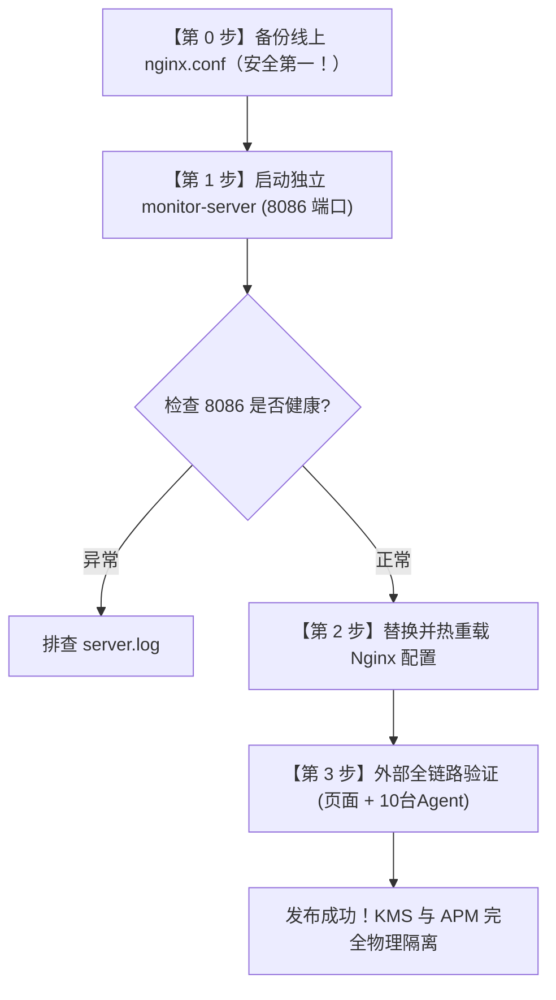

# 🚀 LightPulse APM 独立服务端（完全隔离 KMS）生产发布与回滚手册

> **发布目标**：将 LightPulse APM 服务端作为独立 Spring Boot 进程部署在 `172.18.2.125:8086`，与原有 KMS 主程序物理隔离。通过 Nginx 网关透明分流，**现有 10 台生产服务器上的 Agent 配置 100% 保持原样，无需做任何修改**。

---

## 🛡️ 核心保障与安全确认

1. **即使独立 Server 挂了，KMS 业务会受影响吗？**
   * **绝对不会！** 独立 Server 运行在独立端口 `8086`，分配独立 JVM 内存（256m~512m），完全不占用 KMS 的内存、线程池与 CPU。它若异常退出，KMS 业务依然 100% 正常运行。
2. **KMS 兜底与极速回滚机制**：
   * 原有 KMS 内置的 starter 仍可作为备用兜底。
   * **只要还原 `nginx.conf` 并执行 `nginx -s reload`（耗时仅 1 秒）**，所有监控流量便瞬间切回原 KMS 架构。因此**第一步必须备份 Nginx 配置**！

---

## 📌 部署全流程一览



---

## 🛠️ 详细发布步骤

### 步骤 0：【必须第一步执行】备份线上 Nginx 配置

登录 Nginx 所在网关服务器，执行带时间戳的配置备份：

```bash
# 1. 查看当前 Nginx 主配置文件位置
nginx -t

# 2. 备份主配置文件（通常为 /etc/nginx/nginx.conf）
sudo cp /etc/nginx/nginx.conf /etc/nginx/nginx.conf.bak.$(date +%Y%m%d_%H%M%S)

# 3. 确认备份文件生成成功
ls -l /etc/nginx/nginx.conf.bak.*
```

---

### 步骤 1：部署并启动独立监控服务端（在 172.18.2.125 机器）

#### 1. 上传服务端产物包
将本地已构建完成的 `deploy-linux/server` 目录上传至目标服务器（例如 `/app/monitor-server`），其包含文件：
* `monitor-server-1.0.0-SNAPSHOT.jar`（核心服务端，包含最新折叠分组、严格精准匹配与幽灵实例清理）
* `start.sh`（一键启动脚本）
* `stop.sh`（优雅停止脚本）
* `status.sh`（状态检查脚本）
* `data/storage-config.json`（ES 存储配置，复用现有 `172.18.4.106:9200`）

#### 2. 赋予脚本执行权限并启动
```bash
cd /app/monitor-server
chmod +x *.sh

# 启动服务（内置分配 256MB~512MB 内存，G1GC，端口 8086，上下文路径 /apm）
./start.sh
```

#### 3. 验证 8086 内部健康状态
```bash
# 查看进程与端口状态
./status.sh

# 通过 curl 验证本地响应
curl -I http://127.0.0.1:8086/apm/
# 或测试健康检查接口
curl -s http://127.0.0.1:8086/apm/api/v1/probes/health
```
> [!NOTE]
> 如果看到 HTTP 200 或 302，说明独立服务端已在 8086 端口就绪，随时可以接收外部流量！

---

### 步骤 2：替换并热重载 Nginx（热更新，线上业务 0 中断）

本地已生成的完整配置文件位于项目目录：[others/nginx.conf](file:///d:/workspace/mine/aps/others/nginx.conf)

#### 1. 核心转发规则解析（Nginx 已内置兼容现有 10 台 Agent）
```nginx
# 1. 监控中心上游（直指刚刚启动的 8086 独立进程）
upstream monitor_backend {
    server 172.18.2.125:8086 max_fails=3 fail_timeout=30s;
}

# 2. 拦截控制台访问（浏览器看大屏）
location /kms_backend/apm/ {
    proxy_pass http://monitor_backend/apm/;
    proxy_set_header Host $host;
    proxy_set_header X-Real-IP $remote_addr;
    proxy_set_header X-Forwarded-For $proxy_add_x_forwarded_for;
    proxy_http_version 1.1;
    proxy_set_header Connection "";
    proxy_buffering off;
}

# 3. 拦截 10 台既有 Agent 的直接上报（保持原 serverUrl: /kms_backend 0改动）
location /kms_backend/api/v1/agent/ {
    proxy_pass http://monitor_backend/apm/api/v1/agent/;
    proxy_set_header Host $host;
    proxy_set_header X-Real-IP $remote_addr;
    proxy_set_header X-Forwarded-For $proxy_add_x_forwarded_for;
    proxy_http_version 1.1;
    proxy_set_header Connection "";
    proxy_buffering off;
}

# 4. 原有 KMS 业务主接口保持原样不变
location /kms_backend/ {
    proxy_pass http://kms_backend/;
    ...
}
```

#### 2. 将修改好的配置文件上传并重载
```bash
# 1. 覆盖服务器上的 nginx.conf
sudo cp /path/to/uploaded/nginx.conf /etc/nginx/nginx.conf

# 2. 必须先测试语法！
sudo nginx -t

# 3. 仅当显示 syntax is ok && test is successful 时，平滑重载：
sudo nginx -s reload
```
> [!TIP]
> `nginx -s reload` 是工作进程平滑切换，已有的 KMS 线上连接不会断开，耗时仅 0.1 秒。

---

### 步骤 3：全链路生产验收

1. **控制台访问验证**：
   * 浏览器打开：`https://aikms.jinkosolar.com/kms_backend/apm/`
   * 检查看板显示：
     * 是否出现按 `所属服务(appName)` 折叠的手风琴分组卡片。
     * 点击 `[全部收起]` / `[全部展开]`，测试分组交互。
     * 确认 144 机器的内存正常显示为真实占用（约 6.4%，无虚高）。
2. **Agent 上报验证**：
   * 任意选一台已部署 Agent 的机器（如 144），查看其 `agent.log`：
     ```bash
     tail -f agent.log
     ```
   * 确认日志持续打印：`[HttpReporter] 上报成功 / [HeartbeatManager] 心跳正常`。
   * 服务端日志 `/app/monitor-server/server.log` 同步看到各机器的心跳汇入。
3. **KMS 主业务复核**：
   * 打开 KMS 前端或 Postman，随意请求一个原有业务接口（如对话、登录），确保原有业务一切如常。

---

## 🚨 应急回滚预案（1 秒极速恢复）

如果独立 Server 出现任何不可预期的异常，执行以下命令在 **1 秒内**切回 KMS 兜底：

```bash
# 1. 将步骤 0 备份的文件恢复覆盖
sudo cp /etc/nginx/nginx.conf.bak.<刚才的时间戳> /etc/nginx/nginx.conf

# 2. 测试并平滑重载 Nginx
sudo nginx -t && sudo nginx -s reload
```

**回滚效果**：所有监控流量瞬间恢复打向原本 KMS 进程内部，线上业务与监控全量回退到发布前状态，零数据与业务风险！
